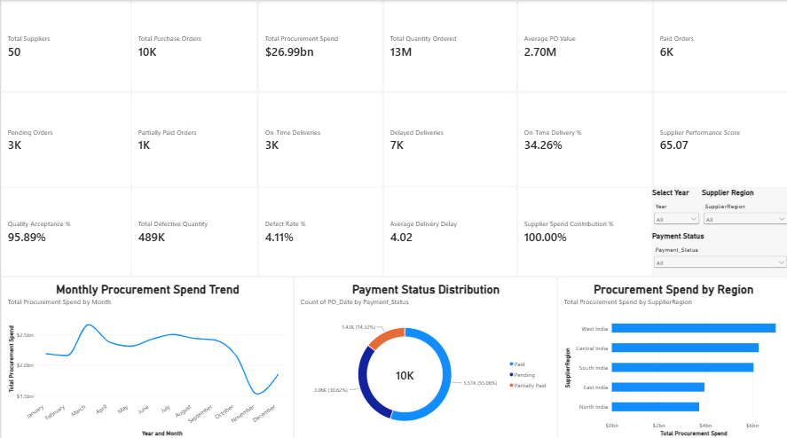
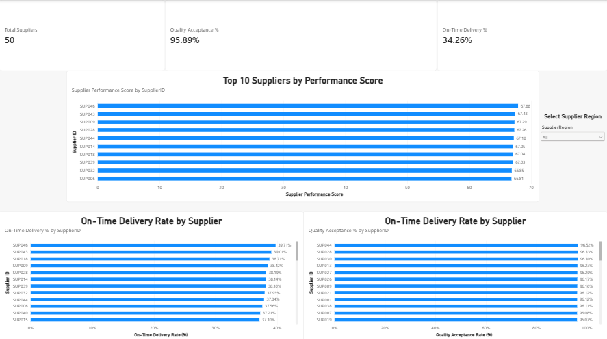
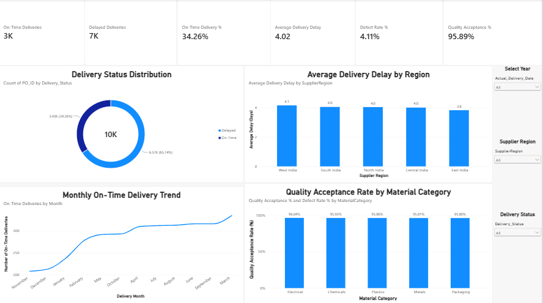
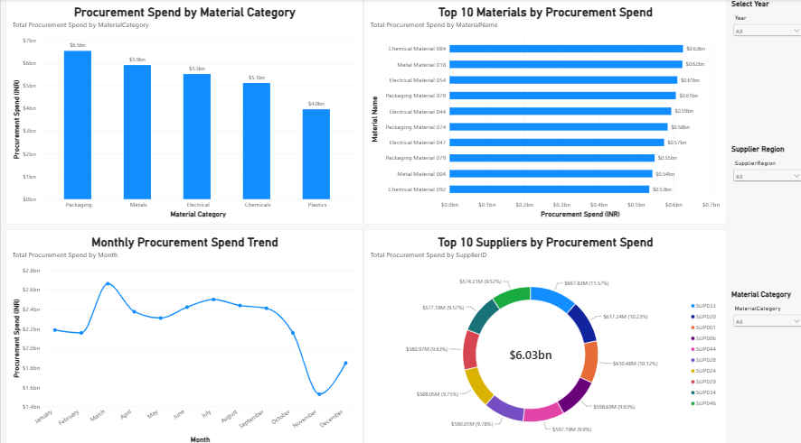

# Manufacturing Procurement & Supplier Performance Analytics

## 1. Project Overview

Manufacturing Procurement & Supplier Performance Analytics is an end-to-end data analytics project that analyses manufacturing procurement data to understand procurement spending, supplier performance, delivery delays, payment status and material quality.

The project uses Microsoft Excel for data preparation, cleaning and quality validation. MySQL is used for storing and analysing procurement data through SQL queries, while Power BI is used to create interactive dashboards for visualising procurement spend, supplier performance, delivery performance and material quality.

The main objective is to transform procurement data into meaningful business insights that can support better procurement decisions.

## 2. Business Problem

Manufacturing organisations depend on suppliers to deliver materials on time and meet quality requirements.

Without proper procurement analysis, organisations may face challenges such as:

- Difficulty monitoring procurement spending.
- Frequent supplier delivery delays.
- High pending payment values.
- Limited visibility into supplier performance.
- Difficulty identifying material quality issues.
- Lack of consolidated procurement reporting.

This project addresses these challenges by analysing procurement data using Excel, MySQL and Power BI.

## 3. Project Objectives

- Prepare and clean procurement datasets using Microsoft Excel.
- Perform data-quality checks and validation.
- Store validated data in MySQL.
- Analyse procurement spending and purchase order activity.
- Review paid, pending and partially paid purchase orders.
- Evaluate supplier performance.
- Analyse delivery delays and on-time delivery rates.
- Identify material quality and defect trends.
- Develop interactive Power BI dashboards.
- Provide business insights and recommendations.

## 4. Technologies Used

| Technology | Purpose |
|---|---|
| Microsoft Excel | Data preparation, cleaning and validation |
| MySQL | Database creation and data storage |
| SQL | Procurement data analysis |
| Power BI | Interactive dashboard development |
| DAX | Dashboard calculations and measures |
| GitHub | Project version control and sharing |

## 5. Dataset Description

The project contains five datasets.

| Dataset | Records |
|---|---:|
| Purchase Orders | 10,000 |
| Suppliers | 50 |
| Materials | 100 |
| Deliveries | 10,000 |
| Quality Inspection | 10,000 |
| Total | 30,150 |

Historical Period: January 2024 – November 2026.

### Dataset Files

The main Excel workbook contains:

- Purchase_Orders
- Suppliers
- Materials
- Deliveries
- Quality_Inspection
- Data_Dictionary

## 6. Project Workflow

The project follows the workflow below:

1. Dataset Preparation using Excel.
2. Data Inspection and Understanding.
3. Data Cleaning and Validation.
4. Data Quality Report Preparation.
5. MySQL Database Creation.
6. Data Import into MySQL.
7. SQL-Based Data Analysis.
8. Power BI Data Modelling.
9. DAX Measure Creation.
10. Dashboard Development.
11. Business Insights and Recommendations.
12. Project Documentation.

## 7. Data Cleaning and Quality Validation

Microsoft Excel was used to prepare and validate the five datasets before importing them into MySQL.

The validation process included:

- Duplicate record checks.
- Missing-value checks.
- Calculation validation.
- Reference ID validation.
- Data consistency checks.
- Delivery date and delay validation.
- Quality inspection validation.

### 7.1 Purchase Orders

- Total records: 10,000.
- Duplicate PO_ID values: 0.
- Missing values: 0.
- Incorrect total amount calculations: 0.
- Invalid Supplier ID references: 0.
- Invalid Material ID references: 0.

### 7.2 Suppliers

- Total records: 50.
- Duplicate Supplier IDs: 0.
- Missing values: 0.
- Duplicate contact emails: 0.
- Invalid lead-time records: 0.
- Invalid supplier status records: 0.

### 7.3 Materials

- Total records: 100.
- Duplicate Material IDs: 0.
- Missing values: 0.
- Duplicate material names: 0.
- Invalid unit-cost records: 0.
- Invalid units of measurement: 0.
- Invalid material categories: 0.

### 7.4 Deliveries

- Total records: 10,000.
- Duplicate Delivery IDs: 0.
- Missing values: 0.
- Invalid PO_ID references: 0.
- Invalid received quantity records: 0.
- Incorrect delay calculations: 0.
- Incorrect delivery status records: 0.

### 7.5 Quality Inspection

- Total records: 10,000.
- Duplicate Inspection IDs: 0.
- Missing values: 0.
- Invalid PO_ID references: 0.
- Incorrect quantity relationships: 0.
- Incorrect defect-rate calculations: 0.

### Data Quality Outcome

- Total records validated: 30,150.
- Total validation checks: 32.
- All five datasets received an overall PASS status.

The validation results are documented in the Excel Data Quality Report.

## 8. SQL Analysis Using MySQL

The validated datasets were imported into the MySQL database:

`procurement_analytics`

The database contains five tables:

- purchase_orders
- suppliers
- materials
- deliveries
- quality_inspection

SQL analysis covered:

- Total procurement spend.
- Total purchase orders.
- Average purchase order value.
- Payment status analysis.
- Pending payment value.
- Supplier performance scoring.
- On-time and delayed deliveries.
- Average delivery delay.
- Quality acceptance rate.
- Defect rate.
- Regional procurement spending.
- Material and category spending.
- Monthly procurement trends.
- Duplicate purchase order checks.

## 9. Key Business Insights

### 9.1 Procurement Spend Analysis

| Metric | Result |
|---|---:|
| Total Purchase Orders | 10,000 |
| Total Procurement Spend | ₹26,988,100,469.51 |
| Average PO Value | ₹2,698,810.05 |
| Total Quantity Ordered | 12,661,134 |

Insights:

- Total procurement spend is approximately ₹26.99 billion.
- West India recorded the highest total procurement spend.
- East India recorded the highest average spend per supplier at approximately ₹5.65 crore.

### 9.2 Payment Status Analysis

| Payment Status | Orders | Percentage |
|---|---:|---:|
| Paid | 5,506 | 55.06% |
| Pending | 3,062 | 30.62% |
| Partially Paid | 1,432 | 14.32% |

Insights:

- 55.06% of purchase orders are Paid.
- 30.62% are Pending.
- 14.32% are Partially Paid.
- Pending payment value is approximately ₹8.25 billion.

### 9.3 Delivery Performance Analysis

| Delivery Status | Deliveries | Percentage |
|---|---:|---:|
| On Time | 3,426 | 34.26% |
| Delayed | 6,574 | 65.74% |

Insights:

- Overall on-time delivery rate is 34.26%.
- 65.74% of deliveries are delayed.
- Average delivery delay is approximately 4.02 days.
- West India has an average delay of approximately 4.14 days.
- East India has the lowest regional average delay at approximately 3.81 days.
- 29 suppliers have an on-time delivery rate below 35%.

### 9.4 Quality Performance Analysis

| Quality Metric | Result |
|---|---:|
| Inspected Quantity | 11,898,714 |
| Accepted Quantity | 11,409,564 |
| Defective Quantity | 489,150 |
| Quality Acceptance Rate | 95.89% |
| Defect Rate | 4.11% |

Insights:

- Overall quality acceptance rate is 95.89%.
- Overall defect rate is 4.11%.
- Packaging has the highest category defect rate at approximately 4.20%.
- Electrical has the lowest category defect rate at approximately 3.96%.

### 9.5 Supplier Performance Analysis

Supplier performance was calculated using equal weighting:

Supplier Performance Score = (On-Time Delivery Rate × 50%) + (Quality Acceptance Rate × 50%)

Insights:

- Average supplier performance score is approximately 65.06.
- Highest recorded score is approximately 67.88 for SUP046.
- Lowest recorded score is approximately 59.95.
- 29 suppliers have on-time delivery below 35%.
- Six suppliers meet both observed thresholds of at least 35% on-time delivery and 96% quality acceptance.

## 10. Business Recommendations

The following recommendations are based on the analysis results.

| Area | Observation | Recommendation |
|---|---|---|
| Delivery Performance | 65.74% deliveries are delayed | Review suppliers with low on-time delivery rates and identify delay reasons. |
| Supplier Management | 29 suppliers have on-time delivery below 35% | Introduce regular supplier performance reviews. |
| Pending Payments | Pending payment value is approximately ₹8.25 billion | Review pending payments and reconcile invoice records. |
| Packaging Quality | Packaging has the highest defect rate | Investigate recurring packaging defects and work with suppliers on corrective actions. |
| Quality Monitoring | Overall defect rate is 4.11% | Monitor defects by supplier and material category. |
| Regional Performance | West India has the highest procurement spend | Review high-spend suppliers and regional delivery performance. |
| Data Quality | All five datasets passed validation | Continue regular data-quality checks. |

## 11. Power BI Dashboard

An interactive Power BI dashboard was developed to analyse procurement spending, supplier performance, delivery performance and material quality.

The dashboard contains four pages.

### 11.1 Procurement Overview

This page provides an overall view of procurement activities.

It includes:

- Total procurement spend.
- Total purchase orders.
- Total suppliers.
- Total quantity ordered.
- Average PO value.
- Payment status distribution.
- Monthly procurement spend trend.
- Procurement spend by region.
- Year, supplier region and payment status slicers.



### 11.2 Supplier Performance

This page analyses supplier performance.

It includes:

- Top 10 suppliers by performance score.
- On-time delivery rate by supplier.
- Quality acceptance rate by supplier.
- Supplier region slicer.



### 11.3 Delivery & Quality Analysis

This page focuses on delivery and quality performance.

It includes:

- Delivery status distribution.
- Average delivery delay by supplier region.
- Monthly on-time delivery trend.
- Quality acceptance rate by material category.
- Defect rate information.
- Delivery year, supplier region and delivery status slicers.



### 11.4 Spend & Material Analysis

This page provides insights into procurement spending.

It includes:

- Procurement spend by material category.
- Top 10 materials by procurement spend.
- Monthly procurement spend trend.
- Top 10 suppliers by procurement spend.
- Purchase order year, supplier region and material category slicers.



## 12. Project Documentation

The project includes:

### Business Requirements Document (BRD)

Describes the business problem, project objectives, scope and business requirements.

### Functional Requirements Document (FRD)

Describes the data sources, dashboard functions, measures and interactive features.

### Final Project Report

Documents the complete project workflow, Excel validation, SQL analysis, business insights, recommendations and Power BI dashboard.

All documents are available in Word and PDF formats in the Documentation folder.

## 13. Project Folder Structure

```text
Manufacturing Procurement & Supplier Performance Analytics/
│
├── Data_Quality/
│   └── Manufacturing_Procurement_Data_Quality_Report.xlsx
│
├── Dataset/
│   ├── Deliveries
│   ├── Materials
│   ├── Purchase_Orders
│   ├── Quality_Inspection
│   └── Suppliers
│
├── Documentation/
│   ├── Manufacturing_Procurement_BRD.docx
│   ├── Manufacturing_Procurement_BRD.pdf
│   ├── Manufacturing_Procurement_FRD.docx
│   ├── Manufacturing_Procurement_FRD.pdf
│   ├── Manufacturing_Procurement_Final_Project_Report.docx
│   └── Manufacturing_Procurement_Final_Project_Report.pdf
│
├── Excel/
│   └── Manufacturing_Procurement_Dataset.xlsx
│
├── Images/
│   ├── Procurement_Overview.png
│   ├── Supplier_Performance.png
│   ├── Delivery_Quality_Analysis.png
│   └── Spend_Material_Analysis.png
│
├── MySQL/
│   └── procurement_database.sql
│
├── PowerBI/
│   └── Manufacturing_Procurement_Dashboard.pbix
│
├── README.md
├── .gitignore
└── REQUIREMENTS.md

## 14. Project Conclusion

This project provided me with practical experience in completing an end-to-end data analytics workflow using Microsoft Excel, MySQL and Power BI.

I started by preparing and cleaning the manufacturing procurement datasets in Excel. I then performed 32 data-quality validation checks across five datasets and documented the results in a separate data-quality report. All five datasets received an overall PASS status before being imported into the MySQL database.

After importing the data into MySQL, I used SQL queries to analyse procurement spending, purchase order activity, payment status, supplier performance, delivery delays and material quality.

I then connected Power BI to MySQL and developed a four-page interactive dashboard. The dashboard presents the findings through KPI cards, charts, supplier and material comparisons, monthly trends and interactive slicers.

The key findings highlighted areas that may need further attention:

- 65.74% of deliveries were recorded as delayed.
- Pending payment value was approximately ₹8.25 billion.
- 29 suppliers recorded an on-time delivery rate below 35%.
- Packaging had the highest material-category defect rate at approximately 4.20%.
- Procurement spending and delivery performance differed across supplier regions.

Based on these findings, I proposed recommendations to improve delivery reliability, strengthen supplier performance monitoring, review pending payments, investigate packaging defects, assess regional performance and continue regular data-quality checks.

Overall, this project helped me strengthen my practical skills in Excel data preparation, data cleaning, data validation, MySQL, SQL querying, Power BI data modelling, dashboard development, business analysis and communicating data-driven recommendations.

It demonstrates how procurement data can be prepared, analysed and presented as meaningful business information to support procurement monitoring and operational decision-making.